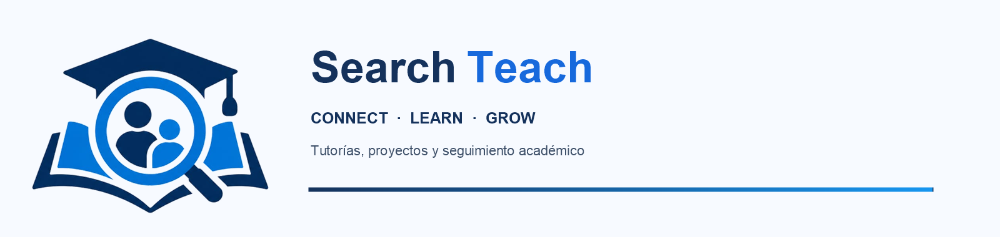

  

  Plataforma académica para conectar estudiantes, docentes y equipos institucionales mediante tutorías, proyectos de aula y seguimiento académico.

  
  
  
  

## Acerca del proyecto

SearchTeach reúne en una sola plataforma la solicitud y programación de tutorías, las sesiones colectivas y los proyectos de aula. Los estudiantes encuentran apoyo académico; los docentes acompañan sesiones y proyectos; coordinación organiza horarios y grupos; y dirección consulta indicadores institucionales.

La aplicación está construida con Flutter y un backend REST en Java con Spring Boot. MongoDB conserva usuarios, tutorías y proyectos. Redis apoya funciones de tiempo real. Las sesiones virtuales e híbridas pueden usar LiveKit; las notificaciones push usan Firebase Cloud Messaging cuando está configurado.

## Roles y funciones

SearchTeach tiene cuatro roles de acceso institucional. Las cuentas académicas se gestionan dentro del rol `USER` y pueden tener perfil de estudiante, docente o ambos. El perfil académico y los permisos institucionales son conceptos distintos.

| Rol de acceso | Funciones principales |
| --- | --- |
| **Usuario académico (`USER`)** | Accede al perfil de estudiante, docente o combinado definido para su cuenta. |
| **Coordinación (`COORDINATOR`)** | Consulta el directorio docente, organiza horarios por carrera y semestre, asigna materias y crea o administra grupos de tutorías colectivas. |
| **Dirección / líder de programa (`DIRECTOR`)** | Consulta indicadores institucionales, calidad y asistencia; revisa el pronóstico de asistencia y los informes y tendencias de proyectos colectivos. |
| **Administración TI (`ADMIN`)** | Administra cuentas y estados de acceso, consulta estadísticas, asigna materias docentes y revisa certificaciones. |

### Perfiles académicos

- **Estudiante:** busca docentes y horarios disponibles; solicita tutorías; se inscribe o retira de sesiones grupales; participa en sesiones virtuales o híbridas; crea o se une a proyectos de aula; consulta sesiones, historial, asistencia, reuniones y avisos.
- **Docente:** administra su perfil académico, títulos, materias y certificaciones; atiende tutorías individuales y colectivas; registra asistencia; consulta sus sesiones y proyectos; comparte chat y videollamadas cuando la sesión lo permite.
- **Docente y estudiante:** una cuenta cuyo perfil incluya ambos roles conserva el acceso estudiantil y puede cambiar a las funciones docentes desde el perfil. No necesita cuentas separadas para cada función.
- **Líder de proyecto de aula (Líder PA):** función adicional para docentes designados como líderes en una cohorte colectiva. Revisa avances, coordina reuniones y participa en confirmaciones de sesiones o cierre de proyectos. No es un quinto rol de autenticación independiente.

## Funcionalidades destacadas

### Tutorías

- consulta de docentes disponibles por materia, tecnología/carrera y semestre.
- Programación de tutorías colectivas para grupos de hasta cinco estudiantes.
- Inscripción y retiro explícitos de tutorías grupales.
- Registro de asistencia y separación entre sesiones activas e historial.
- Solicitudes de cambio de fecha y notificaciones sobre actualizaciones.

### Proyectos de aula

- Coordinación configura cohortes con docente líder y docentes de apoyo.
- Estudiantes crean proyectos o se inscriben mediante un código, según el espacio disponible.
- Cada proyecto admite hasta cuatro estudiantes en el flujo de cohortes.
- Docentes responsables registran sesiones e informes periódicos de avance.
- El líder de proyecto revisa reuniones, avances y solicitudes de cierre.
- Los mensajes de las sesiones se distribuyen en tiempo real; Redis apoya el flujo y MongoDB conserva la información del proyecto.

### Sesiones virtuales e híbridas

- Las sesiones compatibles pueden abrir una sala de audio y video con LiveKit.
- La API autoriza a docentes asignados y estudiantes inscritos antes de emitir un token temporal.
- El chat en sala se intercambia en vivo. El historial de chat de LiveKit no se conserva después de terminar la sala.
- Las credenciales administrativas de LiveKit pertenecen únicamente al backend.

### Indicadores y modelos predictivos

- **Pronóstico de asistencia:** dirección consulta la predicción de asistencia por materia para tutorías futuras compatibles con las categorías del modelo Weka Logistic entrenado desde `src/main/resources/models/asistencia.arff`.
- **Calidad y actividad:** el panel resume tutorías registradas, realizadas y programadas, tasa de asistencia, actividad semanal y datos agregados por materia.
- **Tendencia de proyectos:** los informes de avance permiten observar tendencias y estimaciones de progreso a partir de las valoraciones registradas.
- **Límites de interpretación:** el modelo de asistencia está entrenado con datos sintéticos de demostración; sus predicciones no son una estimación validada de asistencia real. Las tendencias de progreso describen los informes y no prueban que la tutoría haya causado un cambio.

### Notificaciones y cuentas

- Bandeja de notificaciones dentro de la aplicación, contador de avisos no leídos y marcado de avisos como leídos.
- Registro de dispositivos para notificaciones push con Firebase cuando el servicio está habilitado y configurado.
- Registro con verificación de correo institucional y recuperación de contraseña mediante código, con envío de correo configurado en el backend.
- Administración de usuarios, estado de acceso, certificaciones docentes y asignaturas según los permisos del rol.

